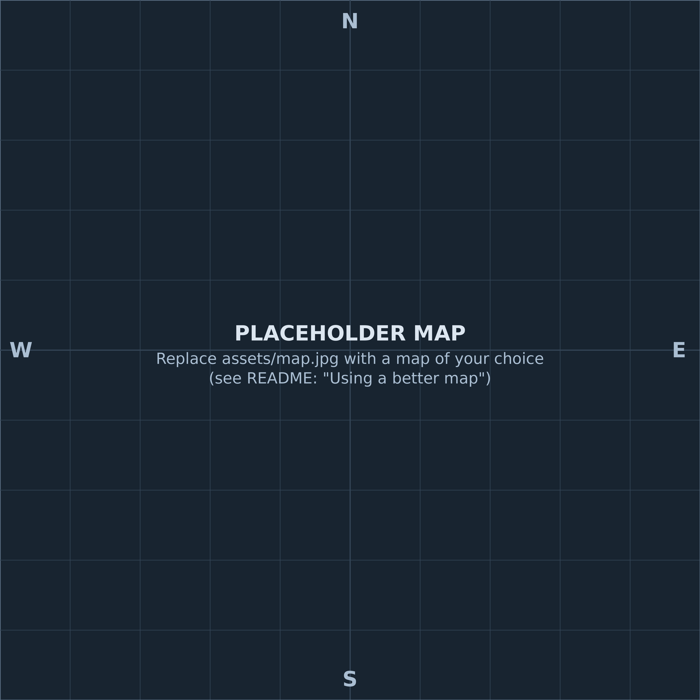

# satwatch 1.3 - Satisfactory save watcher + dashboard

A small local dashboard that reads your Satisfactory save files and shows milestone and space elevator progress, a building map, Dimensional Depot gaps, a volume view of your items and a transport planning grid. It runs only on your own PC (Python standard library, no network, served on 127.0.0.1) and never changes your saves. It was built entirely by describing the idea to an AI assistant (Grok Bot); try the same with your own tracking problems. Unofficial fan tool, not affiliated with or endorsed by Coffee Stain Studios.

## Your plan file: `plan.json` (the one file you edit)
`plan.json` lives in the **work folder** (`%USERPROFILE%\satisfactory-work\plan.json`), not in the satwatch program folder and not in the vault. It is the only user-edited file. Updating satwatch (replacing the `satwatch\` folder from a new zip) never touches it. You edit it in the dashboard; you don't need to open it by hand.
- Each change is written atomically (temp file, then rename). Every changed version is also copied to `plan_backups\plan-YYYYmmdd-HHMMSS.json`; the newest 30 are kept.
- If `plan.json` can't be read, satwatch renames it to `plan.corrupt-<time>.json`, starts with an empty plan and shows a warning. To recover, copy a file from `plan_backups\` back to `plan.json`.
- The vault gets a read-only `plan.md` (rewritten every run and after each dashboard edit). Edits made to `plan.md` are overwritten; satwatch never reads it back.

## What's new in 1.3
- **Transport plan** (Volume items panel): click a Depot, Drone or Train cell, or focus it with Tab and press Enter or Space, to mark it "want". A second click clears it. Planned cells get a blue outline and a "planned" tag. When the newest save shows the item on that network, the tag reads "planned ✓ now exists"; the want stays until you clear it. You also get a "Planned" filter, "Planned depot/drone/train" count tiles, and an optional note per item (open the item's detail line, then "save note"). `volume_items.json` gains a `planned` map.
- **Factory designs**: the factory card (click a chip or a box on the map) has a Design section: name, purpose, notes and a design URL. Any http(s) link of up to 32 KB is stored exactly as given, for example a long satisfactory-calculator link. "Open design" opens the link in a new tab. Chips and map boxes show a link badge when a design is set and a muted style when it isn't.
- **Next factory**: a "Next factory" chip and a blue diamond map marker. Its position defaults to the pioneer; "Set position on map" and then a click on the map moves it.
- New panels ported from the tracker Page: Milestone history (first save each change shows up in), Factory census (by category, with bars), Inventory & collectibles (hard drives, somersloops, mercer spheres and power slugs carried, most ever carried, still in the world, drop pods, player inventory highlights), building-count bars on the factory card, and a fuller "What the parser couldn't read" list (this run's warnings plus fixed caveats). The header shows play time, last save, start date, buildings and saves parsed.
- **To-do (from the vault)**: shows `Field Ledger\games\satisfactory\todo.md` (the folder above the data folder), read-only, as simple markdown. All HTML in the file is shown as text. The panel is hidden when the file doesn't exist.
- Security of the edit endpoints (`GET /api/plan`, `POST /api/plan/factory`, `POST /api/plan/transport`): the server listens on 127.0.0.1 only. Requests must use Host 127.0.0.1 or localhost with the dashboard port, and a cross-site Origin is refused. Each POST needs a random per-run token from the page. Bodies are limited to 64 KB, text fields have length limits, and design links must be http or https. `plan.json` is the only file the server can write.

## What was new in 1.2
- **Volume items** panel on the dashboard (same table as the tracker Page, now computed live from your newest save): summary tiles, filters (All / Not on any network or depot / No drone route / No train), header pinned above a 560 px scroll box, amber tier bands with counts, a "packaged" badge, and hover / focus (Tab) / tap detail lines showing what each item makes (★in save = a factory in the save runs that recipe).
- Columns: Item, Level, Made at (F1-F13 from `factories_boxes.json`), Depot amount, Drone network (paired routes, plus "port only" for unpaired ports), Train network (timetable stops and platforms).
- Every run writes `volume_items.json` and `volume_items.md` to the vault folder and adds a one-line "Volume items" section to `status.md`. `/api/volume` returns the same data.
- **Outpost at the pioneer** panel: player position and nearest factory box with distance. (Resource nodes and inventory are not included yet.)
- `satparse.py` 0.4 adds an additive `network` field to snapshots: machine recipes and positions, drone ports (name, pairing, inventories), train stations, timetables, freight platforms and the player position. It also decodes TextProperty values (station names). The first run after updating re-parses the newest save once (about 1 s).
- New **Satisfactory Refresh.bat**: refreshes the vault files without starting the dashboard (`--no-serve`); its window stays open only on an error.

### Volume rule
A row is any item that is an ingredient of an unlocked machine recipe whose product is a part, fluid, fuel or Space Elevator / project part. Buildings, decorations, equipment, ammo, nobelisks, rebar, filters, medical items, power shards, alien and biomass items don't count, as rows or as consumers. Raw resources are not rows. Fluids are not rows; their packaged forms are, when used in a volume recipe or shipped by drone or train. Unpackage recipes are skipped, except as a note on packaged rows.
- Tier = the lowest milestone (or tutorial) tier that unlocks a standard (non-alternate) machine recipe for the item; a default recipe needing no unlock is Tier 0; items only reachable through MAM / alternates are "MAM / alternate-only". Hand-set: Plastic 5, Rubber 5, Empty Canister 5, Empty Fluid Tank 8.
- Made at: each machine joins the factory box it sits in (nearest centroid if boxes overlap), else the nearest box within 300 m, else `F?`. A new site outside all boxes shows `F?` until you re-derive `factories_boxes.json`.
- Drone routes are `F<src> "<source port>" -> F<dst> "<port>"` for each item in the destination port's inventories. Train entries are timetable stops (load/unload) and freight platforms holding the item (each platform belongs to its nearest station).
- Game data: `assets/sf-data1.0-volume.json` (50 KB), trimmed from SatisfactoryTools `data/data1.0.json` (https://github.com/greeny/SatisfactoryTools, MIT License, Copyright (c) 2019 greeny; game names (c) Coffee Stain Studios).
- Standalone: `python volume.py <save.sav | snapshot.json> --out volume_items`.

Double-click **Satisfactory Update.bat** (or **Satisfactory Refresh.bat** to update the vault files only). It uses `C:\Python314\python.exe`, else `py -3`, else `python`. Stdlib only. No installs and no network access.

Each run does the following:
1. Finds `Miners Farm*.sav` in `%USERPROFILE%\AppData\Local\FactoryGame\Saved\SaveGames\76561197968480163`.
2. Parses only new or changed saves with `satparse.py` (Helm's parser, version 0.4, shipped beside satwatch.py). A save counts as parsed when `state.json` has the same name, size and mtime. Without a state entry, an existing `snaps\<name>.json` with the same file_size and file_mtime (allowing up to 2.5 s of rounding, which is logged as a note) also counts. A save that fails to parse is logged and the run continues.
3. Rebuilds `timeline.csv` and `timeline.json` in the work folder with satparse's own timeline function.
4. Writes `latest.json`, `timeline.json`, `status.md`, `depot_gap.*`, `volume_items.*`, `plan.md`, the map summary files and `factories_boxes.json` to the vault folder and creates it if it is missing.
5. Serves the dashboard at http://127.0.0.1:8777/ (or the next free port) and opens your browser. Press Ctrl+C or close the window to stop it.

## Folders (defaults, also set at the top of satwatch.py)
- Work: `%USERPROFILE%\satisfactory-work\` (contains `snaps\`, `state.json`, `timeline.*`, `plan.json`, `plan_backups\`, `inventory_peaks.json`)
- Vault: `%USERPROFILE%\Documents\Field Ledger\games\satisfactory\data\`

## Flags
- `--reparse-latest`: re-parse the newest save even if it was already parsed.
- `--backfill-depot`: add depot/recipe/network data to older snapshots (see Depot section).
`--saves DIR` `--work DIR` `--vault-out DIR` `--pattern GLOB` `--port N` `--no-open` `--no-serve` (refresh the files, then exit) `--selftest [--file X.sav]` (parses one save and prints OK or FAIL; exit code 0 or 1; also checks the map capture)
`--maps` (default on: new saves are binned for the map in the same pass) `--no-maps` `--backfill-maps` (re-reads older saves, about 1 s each, to build missing map bins; same as double-clicking `Satisfactory Map Backfill.bat`)

## Map
- `satmap.py` reads building positions without changing `satparse.py`: while a save is parsed it temporarily swaps in a copy of `satparse.parse_object_headers` that reads the 40-byte transform instead of skipping it (marked `MONKEYPATCH` in satmap.py) and restores the original afterwards. satmap's copy also feeds satparse 0.4's network position hook. If satparse's header reader changes, a fingerprint check turns map capture off with a warning instead of guessing.
- Output (work folder): `map_bins\<save>.json` (50 m bins per category, cached by save name + size), `map_bins\<save>.points.json`, `map_bins\latest_points.json` (x/y/z cm + name for production/extraction buildings and the player of the latest save) and `map_bins\map_summary.json`. Only `latest_points.json` and `map_summary.json` are copied to the vault folder.
- Categories: production, extraction, power, logistics, storage/transport (incl. vehicles), structure, other buildings, collectibles still in the world (somersloops, mercer spheres, power slugs, unopened hard-drive crash sites). Building totals equal the snapshot's `buildings_total` (vehicles are counted separately).
- The slider only offers snapshots that have bins. Older snapshots get bins only via `Satisfactory Map Backfill.bat`, and only while their .sav still exists.
- Calibration (one block at the top of satmap.py): X -3246.99..4253.02 m, Y -3750..3750 m (satisfactory.wiki.gg/wiki/World), 1.5 m per pixel. Checked against a 1.1 save: 94% of uncollected collectibles land on land pixels, and the best fit was exactly at these bounds (shifting 5 m in any direction scored worse), so residual error is about 5 m or less.

### Using a better map
satwatch ships with a plain placeholder map (`assets/map_placeholder.png`, a labelled grid with no game art) so the map panel works out of the box. Buildings are drawn in the right places on it, you just don't get terrain.

To see them on a real map:
1. Get a top-down map image of the Satisfactory world from a source you are allowed to use. The in-game map and the community wiki images are (c) Coffee Stain Studios and not freely licensed, so this repo does not include one. You can take your own screenshot of the in-game map, or use a map from a project whose licence you have checked.
2. The image must be **square** and cover the whole playable area: the world from X -3246.99 to 4253.02 m and Y -3750 to 3750 m (north at the top, west at the left). 5000 x 5000 px (1.5 m per pixel) is what the calibration assumes, but any square size works because positions are drawn proportionally.
3. Save it as `assets/map.jpg` (`map.png`, `map.jpeg` or `map.webp` also work). satwatch uses the first of those it finds and falls back to the placeholder.
4. Restart the dashboard (double-click `Satisfactory Update.bat` again) and hard-refresh the browser page.
5. If the buildings look shifted, edit the four numbers `MAP_X0`, `MAP_X1`, `MAP_Y0`, `MAP_Y1` at the top of `satmap.py` to match your image. They are in Unreal centimetres.

`assets/map.jpg` and the other map names are in `.gitignore` so a map you add stays on your PC and is never committed by accident. Please don't redistribute game artwork.

- Satisfactory is (c) Coffee Stain Studios; unofficial fan tool, not endorsed.
- No save data or save-derived data is uploaded anywhere. The dashboard is served on 127.0.0.1 only.

## Factory overlay
- **What it shows:** the map's "Factories" layer (on by default) draws an orange box around each of the 13 factories F1 to F13, labelled "F# name". Train stations are triangles and drone ports are diamonds (orange = output, blue = input, grey = unnamed/other, red = conflict); they have their own toggle. Hover a box for its name, box size, key recipes, building counts, stations and warnings (in yellow). Click a box or a chip under the map to select it, open the side panel and zoom to fit it. Right-click a chip to hide that factory.
- **Data source:** `factories_boxes.json`, shipped beside satwatch.py and copied on each normal run to the vault output folder (`games\satisfactory\data\`) only if the copy there is missing or older. The dashboard reads the satwatch-folder copy first, then the vault copy. If neither exists the layer simply does not appear. It needs no save parsing.
- **It reflects one save:** `Miners Farm_190326-075353.sav` (2026-03-19). Factory names, members and warnings come from Helm's factory analysis (`factories.json`) and the "Unmatched stations" section of the vault `todo.md`. Boxes do not move when you build more; re-derive them after new saves.
- **Box:** covers the factory's production buildings (clustered at 150 m), the extractors attached to it (nearest member within 300 m) and its stations, plus a 100 m margin. The generator checks that every member lies inside its box.

### Re-deriving the boxes
The factory analysis scripts (`extract.py`, `analyze.py`, `report.py` in Helm's `factoryid` workspace) are **not** shipped here. Ask Helm to re-run them on the new save; that produces a new `factories.json` and `raw_objects.json`. Then, in this folder:

    python make_factory_boxes.py --in factories.json --raw raw_objects.json --out factories_boxes.json [--margin-m 100] [--todo "<vault>\games\satisfactory\todo.md"]

`--todo` is optional and read-only; it adds the todo lines that mention each F# to that factory's warnings.

## Dimensional Depot gap check
Rule: *Every item required to build anything unlocked must be in the depot; any unlocked item not in the depot goes on the to-do list.*

- satparse 0.3 also reads the Central Storage subsystem (`mStoredItems`) and the Recipe Manager (`mAvailableRecipes`) into the snapshot as `depot` and `recipes`. These fields are additive; older snapshots simply lack them.
- After each run, `depotgap.py` takes every unlocked build-gun recipe (`forBuilding`) and lists its ingredients. **GAP** means the item has 0 in the depot. **LOW** means it has less than 1 stack (stack size comes from the game data).
- The **Dimensional Depot** panel shows gap items, low items and uploaders built. It compares against the previous snapshot that has depot data: new gap items are red with a NEW badge, and items that left the gap are listed as resolved. `/api/depot` returns the latest result, the previous one and the diff.
- Every normal run writes `depot_gap.json` and `depot_gap.md` to the vault folder from the latest snapshot.
- **First run after updating:** older snapshots were made by satparse 0.2, so they have no depot data. A normal run re-parses only the newest save, which takes about 1 s, and only if its snapshot lacks depot data. If the panel shows "no depot data in this snapshot", run with `--reparse-latest`. For a history diff, double-click `Satisfactory Depot Backfill.bat` (`--backfill-depot`). It re-reads every older save at about 1 s each and prints progress.
- Standalone use: `python depotgap.py <save.sav | snapshot.json> --out depot_gap [--low 1]`.
- Game data: `assets/sf-data1.0-depot.json` (150 KB) is a **trimmed** copy of SatisfactoryTools `data/data1.0.json` (1.7 MB). It keeps only item name/stackSize and recipe name/forBuilding/ingredients. Source: https://github.com/greeny/SatisfactoryTools, MIT License, Copyright (c) 2019 greeny. Game names are (c) Coffee Stain Studios. About 143 unlocked recipes, such as customizer and newer items, are not in that file and are ignored.

## Wiki data (satisfactory.wiki.gg, checked 2026-11-04)
- Milestone names for Tiers 1-9 come from the Milestones page.
- Space Elevator phase 1-5 costs (default multiplier) come from the Space Elevator page.
- **Not on the wiki:**
  - Mapping save IDs (`Schematic_T-N_C`) to milestone names is done from the game's own data (`data1.0.json`), so each milestone shows done or not yet by ID. Sub-unlock IDs such as `Schematic_5-1-1_C` are ignored.
  - Mapping `Desc_SpaceElevatorPart_N_C` to part names. This comes from game knowledge; any unmatched item is shown raw.

## Troubleshooting
- **"Python not found":** install Python 3.14 to `C:\Python314`.
- **Port busy:** the tool tries ports 8777 to 8796, or set one with `--port`.
- **Wrong numbers:** run `--selftest`. To force a re-parse, delete `state.json` and the snapshot json.
- **Pre-1.0 saves (v46):** these predate 1.0, so their elevator phases and tiers may not match the 1.1 tables.
