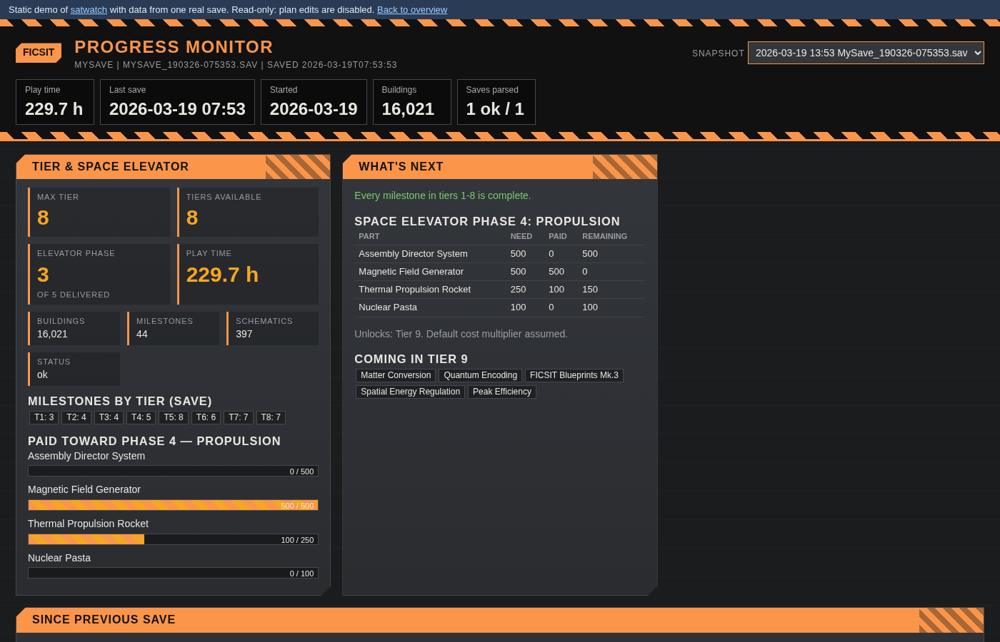
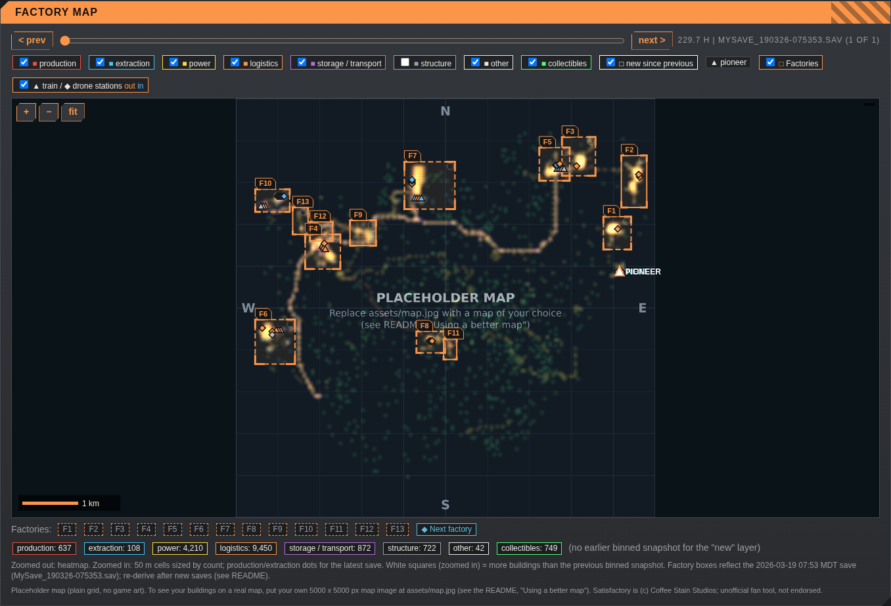
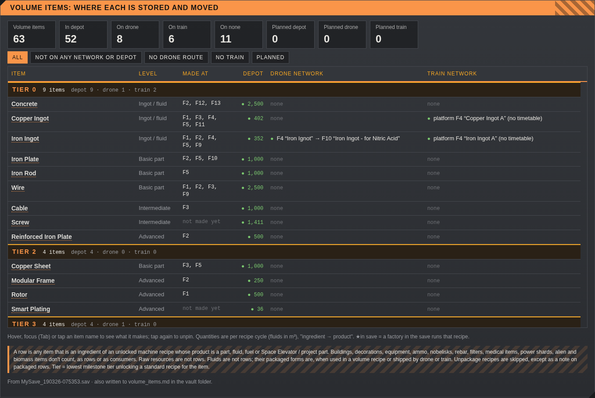
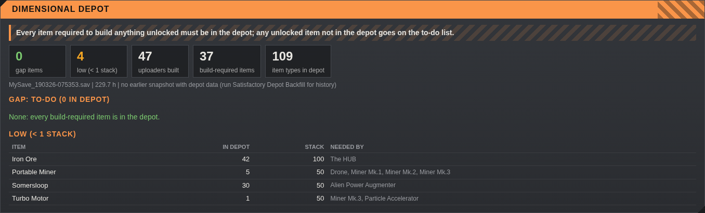
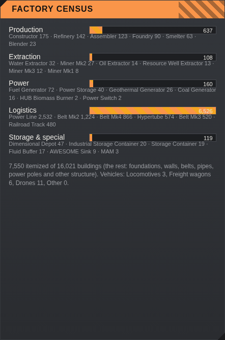

# satwatch: a local dashboard for your Satisfactory saves

satwatch reads your Satisfactory `.sav` files and turns them into a dashboard in your browser: tier and Space Elevator progress, milestone history, a building map, Dimensional Depot gaps, where every item is stored and moved, a factory and transport planning grid, and more. It runs entirely on your own PC with the Python standard library, serves on `127.0.0.1` only, and never writes to your saves.

**Live demo (static, built from a real save):** [docs/demo.html](docs/demo.html) · **Overview page:** [docs/index.html](docs/index.html)

| | |
|---|---|
|  |  |
|  |  |

> Unofficial fan tool. Satisfactory is (c) Coffee Stain Studios. satwatch is not affiliated with or endorsed by Coffee Stain Studios.

## Contents
[Requirements](#requirements) · [Install](#install) · [Configure](#configure) · [First run](#first-run) · [The launchers](#the-launchers) · [Where data is stored](#where-data-is-stored) · [After each save](#after-each-save) · [Command-line flags](#command-line-flags) · [Panels](#panels) · [Plan grid](#plan-grid-and-planjson) · [Map](#map) · [Factory overlay](#factory-overlay) · [Depot gap check](#dimensional-depot-gap-check) · [Troubleshooting](#troubleshooting) · [Privacy](#privacy) · [Limitations](#limitations-and-known-gaps) · [Credits](#data-credits) · [License](#license) · [Changelog](CHANGELOG.md)

## Requirements
- Windows PC with Satisfactory 1.0 or 1.1 saves (the launchers are Windows `.bat` files; the Python code also runs on other systems if you pass the folders as flags).
- Python 3 from [python.org](https://www.python.org/downloads/). Developed on Python 3.14 and also tested on 3.13; a recent 3.x is recommended.
- No `pip install`, no packages, no internet connection. Standard library only.
- A modern browser (Chrome, Edge, Firefox).

## Install
1. Install Python 3. Either install it to `C:\Python314` (the launchers check there first), or tick "Add python.exe to PATH" in the installer, or use the `py` launcher that python.org installs.
2. Download this repository (green **Code** button, then **Download ZIP**) and unzip it to any folder, for example `%USERPROFILE%\satwatch`.
3. Check where your saves are. Satisfactory keeps them in `%LOCALAPPDATA%\FactoryGame\Saved\SaveGames\<id>` (paste `%LOCALAPPDATA%\FactoryGame\Saved\SaveGames` into Explorer's address bar). `<id>` is a long number for your game account.
4. If you have more than one `<id>` folder or more than one save series, set it up as described in [Configure](#configure).
5. Double-click **Satisfactory Update.bat**.

## Configure
Defaults (set at the top of `satwatch.py`):

| Setting | Default | Flag |
|---|---|---|
| Save folder | the single `<id>` folder under `%LOCALAPPDATA%\FactoryGame\Saved\SaveGames` that contains `.sav` files (if there is not exactly one, the `SaveGames` folder itself, which has no saves, so set `--saves`) | `--saves DIR` |
| Save files | `*.sav` (every save in the folder) | `--pattern GLOB` |
| Work folder | `%USERPROFILE%\satisfactory-work` | `--work DIR` |
| Vault / output folder | `%USERPROFILE%\Documents\satwatch\data` | `--vault-out DIR` |
| Port | 8777 (or the next free one up to 8796) | `--port N` |
| Python | `C:\Python314\python.exe`, else `py -3`, else `python` | `PYEXE` in the .bat |

Your folder probably holds several sessions plus autosaves. To track one session, use a pattern that matches its save names, e.g. `--pattern "MySave*.sav"` (Satisfactory names saves `<session>_<date>-<time>.sav` and autosaves `<session>_autosave_N.sav`).

There are two ways to change settings:
- **Edit the .bat files** (simplest for double-clicking). Open each `.bat` in Notepad and fill in the settings line near the top, for example:

      set SATWATCH_ARGS=--saves "%LOCALAPPDATA%\FactoryGame\Saved\SaveGames\12345678901234567" --pattern "MySave*.sav"
      set "PYEXE=C:\Python312\python.exe"

  Use the same `SATWATCH_ARGS` in all four launchers. For `PYEXE`, use a path without spaces (or leave it empty to auto-detect).
- **Pass flags** from a command prompt in the satwatch folder: `"Satisfactory Update.bat" --pattern "MySave*.sav"` or `python satwatch.py --saves "D:\saves" --pattern "MySave*.sav"`. Flags given after the .bat name are added after `SATWATCH_ARGS`.

## First run
1. Double-click **Satisfactory Update.bat**. A console window opens.
2. satwatch parses every matching save it has not seen (about 1 s per save), prints a line per save, and writes its files.
3. It prints `Dashboard: http://127.0.0.1:8777/` and opens your browser there.
4. Leave the window open while you use the dashboard. Press Ctrl+C or close the window to stop it.

Check the parser on one save with `python satwatch.py --selftest` (newest save) or `--selftest --file "path\to\save.sav"`. It prints OK or FAIL and exits with 0 or 1; it also checks the map capture.

## The launchers
All four use the same Python lookup and `SATWATCH_ARGS`, pass any extra flags through, and keep the window open if satwatch exits with an error.

| File | Runs | Use it for |
|---|---|---|
| **Satisfactory Update.bat** | `satwatch.py` | Normal use: parse new saves, refresh files, start the dashboard and open the browser. |
| **Satisfactory Refresh.bat** | `satwatch.py --no-serve` | Update the output files without starting the dashboard (for example before reading `status.md`). |
| **Satisfactory Depot Backfill.bat** | `satwatch.py --backfill-depot` | Re-read older saves (about 1 s each) to add depot, recipe and network data, so the depot panel can show what changed between saves. |
| **Satisfactory Map Backfill.bat** | `satwatch.py --backfill-maps` | Re-read older saves (about 1 s each) to build map bins, so the map slider can step back through history. Only works while the old .sav still exists. |

## Where data is stored
satwatch only **reads** the save folder. It writes to two folders of its own:

- **Work folder** (`%USERPROFILE%\satisfactory-work`): `snaps\<save>.json` (one parsed snapshot per save), `state.json` (which saves were parsed), `timeline.csv` / `timeline.json`, `map_bins\`, `plan.json` and `plan_backups\` (your plan, see below), `inventory_peaks.json` (most of each collectible ever carried).
- **Vault / output folder** (`%USERPROFILE%\Documents\satwatch\data`): readable summaries for notes apps such as Obsidian: `latest.json`, `timeline.json`, `status.md`, `depot_gap.json/.md`, `volume_items.json/.md`, `plan.md` (read-only copy of your plan), `latest_points.json`, `map_summary.json` and `factories_boxes.json`. It is created if missing.
- Optional: a `todo.md` in the folder **above** the vault folder (default `%USERPROFILE%\Documents\satwatch\todo.md`) is shown read-only in the To-do panel.

Snapshots stay after you delete old saves, so your history keeps growing even though the game rotates autosaves.

## After each save
Save in game (or let it autosave), then double-click **Satisfactory Update.bat** again (or **Refresh** if you only want the files). Only new or changed saves are parsed: a save counts as already parsed when `state.json` has the same name, size and modification time (or, without a state entry, an existing snapshot with the same size and time within 2.5 s). A save that fails to parse is logged and the run continues. The timeline and all output files are then rebuilt. The dashboard does not watch for new saves while it runs; re-run the launcher and refresh the page.

## Command-line flags
`python satwatch.py [flags]`

| Flag | Meaning |
|---|---|
| `--saves DIR` | Folder with .sav files. |
| `--work DIR` | Work folder (snaps, state.json, timeline, plan.json). |
| `--vault-out DIR` | Output folder for the summary files (created if missing). |
| `--pattern GLOB` | Which save files to read (default `*.sav`). |
| `--port N` | Dashboard port (default 8777; if busy, the next free port up to 8796). |
| `--no-open` | Do not open the browser. |
| `--no-serve` | Refresh the files, then exit. |
| `--selftest [--file X.sav]` | Parse one save (default: newest) and print OK or FAIL; exit code 0 or 1. |
| `--reparse-latest` | Re-parse the newest save even if it was already parsed. |
| `--backfill-depot` | Re-read older saves to add depot/recipe/network data. |
| `--maps` / `--no-maps` | Bin building positions of new saves for the map (default on) / skip it. |
| `--backfill-maps` | Re-read older saves to build missing map bins. |

Standalone helpers (same folder):
- `python satparse.py <save.sav | folder> --out <dir | file.jsonl> [--timeline] [--pattern "MySave*"] [--skip-existing]`
- `python depotgap.py <save.sav | snapshot.json> --out depot_gap [--low 1] [--data file]`
- `python volume.py <save.sav | snapshot.json> --out volume_items [--boxes factories_boxes.json]`
- `python make_factory_boxes.py --in factories.json --raw raw_objects.json --out factories_boxes.json [--margin-m 100] [--todo todo.md]` (see [Factory overlay](#factory-overlay))

## Panels
Screenshots of every panel: [docs/index.html](docs/index.html).

- **Header:** session, save file and time, play time, last save, start date, buildings and saves parsed. The **Snapshot** selector switches the panels to an older snapshot.
- **Tier & Space Elevator:** highest tier, tiers available, elevator phase delivered, building/milestone/schematic counts, milestones per tier, and a bar per part paid toward the current phase.
- **What's next:** what is still missing in tiers 1-8, the current elevator phase (need / paid / remaining) and the milestones coming in the next tier.
- **Since previous save:** what changed against the previous snapshot (buildings, milestones, session change).
- **Dimensional Depot:** gap and low items against everything you can build, uploaders built, new and resolved items since the previous depot snapshot (see [below](#dimensional-depot-gap-check)).
- **Volume items:** one row per intermediate item: tier, which factory makes it, amount in the depot, drone routes and train stops carrying it, with filters and the transport plan (see [Plan grid](#plan-grid-and-planjson)).
- **Outpost at the pioneer:** your player position and the nearest factory box with distance.
- **Factory map:** buildings by category, factory boxes, stations and drone ports, a snapshot slider and "new since previous" layer (see [Map](#map)).
- **Progress over time:** one chart per metric across all snapshots: play time, buildings, power generators, extractors, milestones, schematics, max tier and elevator phase.
- **Milestone history:** the first snapshot in which each milestone appears.
- **Factory census:** buildings by category, with bars.
- **Inventory & collectibles:** hard drives, somersloops, mercer spheres and power slugs carried, most ever carried, still in the world, drop pods, and player inventory highlights.
- **To-do:** your `todo.md` (optional), read-only, shown as simple markdown; HTML is shown as text.
- **What the parser couldn't read:** this run's parser warnings plus fixed caveats.

## Plan grid and plan.json
The Volume items panel doubles as a transport planning grid, and factory cards hold your factory designs.

- **Transport plan:** click a Depot, Drone or Train cell (or Tab to it and press Enter/Space) to mark it "want"; click again to clear. Planned cells get a blue outline and a "planned" tag, which changes to "planned ✓ now exists" once the newest save shows the item on that network. There is a "Planned" filter, planned count tiles and an optional note per item.
- **Factory designs:** click a factory chip or map box to open its card, with name, purpose, notes and a design URL (any http(s) link up to 32 KB, e.g. a satisfactory-calculator link). "Open design" opens it in a new tab.
- **Next factory:** a chip and a blue diamond on the map. It starts at your pioneer; "Set position on map" and a click moves it.

`plan.json` lives in the **work folder** and is the only file you edit (through the dashboard; no need to open it). Replacing the satwatch folder with a new version never touches it.
- Each change is written atomically and also copied to `plan_backups\plan-YYYYmmdd-HHMMSS.json`; the newest 30 are kept.
- If `plan.json` can't be read, satwatch renames it to `plan.corrupt-<time>.json`, starts an empty plan and shows a warning. To recover, copy a backup back to `plan.json`.
- `plan.md` in the vault folder is a read-only copy, rewritten every run; edits to it are overwritten.
- The edit endpoints only accept requests to 127.0.0.1/localhost on the dashboard port, refuse cross-site origins, need a random per-run token from the page, and limit body and field sizes. `plan.json` is the only file the server can write.

### Volume rule
A row is any item that is an ingredient of an unlocked machine recipe whose product is a part, fluid, fuel or Space Elevator / project part. Buildings, decorations, equipment, ammo, nobelisks, rebar, filters, medical items, power shards, alien and biomass items don't count, as rows or as consumers. Raw resources are not rows. Fluids are not rows; their packaged forms are, when used in a volume recipe or shipped by drone or train. Unpackage recipes are skipped, except as a note on packaged rows.
- Tier = the lowest milestone (or tutorial) tier that unlocks a standard (non-alternate) machine recipe for the item; a default recipe needing no unlock is Tier 0; items only reachable through MAM / alternates are "MAM / alternate-only". Hand-set: Plastic 5, Rubber 5, Empty Canister 5, Empty Fluid Tank 8.
- Made at: each machine joins the factory box it sits in (nearest centroid if boxes overlap), else the nearest box within 300 m, else `F?`. A new site outside all boxes shows `F?` until you re-derive `factories_boxes.json`.
- Drone routes are `F<src> "<source port>" -> F<dst> "<port>"` for each item in the destination port's inventories. Train entries are timetable stops (load/unload) and freight platforms holding the item (each platform belongs to its nearest station).
- Game data: `assets/sf-data1.0-volume.json` (50 KB), trimmed from SatisfactoryTools `data/data1.0.json` (https://github.com/greeny/SatisfactoryTools, MIT License, Copyright (c) 2019 greeny; game names (c) Coffee Stain Studios).
- Standalone: `python volume.py <save.sav | snapshot.json> --out volume_items`.
## Map
- `satmap.py` reads building positions without changing `satparse.py`: while a save is parsed it temporarily swaps in a copy of `satparse.parse_object_headers` that reads the 40-byte transform instead of skipping it (marked `MONKEYPATCH` in satmap.py) and restores the original afterwards. If satparse's header reader changes, a fingerprint check turns map capture off with a warning instead of guessing.
- Output (work folder): `map_bins\<save>.json` (50 m bins per category), `map_bins\<save>.points.json`, `map_bins\latest_points.json` and `map_bins\map_summary.json`. Only the last two are copied to the vault folder.
- Categories: production, extraction, power, logistics, storage/transport (incl. vehicles), structure, other buildings, and collectibles still in the world (somersloops, mercer spheres, power slugs, unopened hard-drive crash sites).
- Zoomed out the map is a heatmap; zoomed in it shows 50 m cells and production/extraction dots. The slider only offers snapshots that have bins (see Map Backfill).
- Calibration (top of satmap.py): X -3246.99..4253.02 m, Y -3750..3750 m (satisfactory.wiki.gg/wiki/World), 1.5 m per pixel. Checked against a 1.1 save: residual error is about 5 m or less.

### Using a better map
satwatch ships with a plain placeholder map (`assets/map_placeholder.png`, a labelled grid with no game art) so the map panel works out of the box. Buildings are drawn in the right places on it, you just don't get terrain.

To see them on a real map:
1. Get a top-down map image of the Satisfactory world from a source you are allowed to use. The in-game map and the community wiki images are (c) Coffee Stain Studios and not freely licensed, so this repo does not include one. You can take your own screenshot of the in-game map, or use a map from a project whose licence you have checked.
2. The image must be **square** and cover the whole playable area: the world from X -3246.99 to 4253.02 m and Y -3750 to 3750 m (north at the top, west at the left). 5000 x 5000 px (1.5 m per pixel) is what the calibration assumes, but any square size works because positions are drawn proportionally.
3. Save it as `assets/map.jpg` (`map.png`, `map.jpeg` or `map.webp` also work). satwatch uses the first of those it finds and falls back to the placeholder.
4. Restart the dashboard (double-click `Satisfactory Update.bat` again) and hard-refresh the browser page.
5. If the buildings look shifted, edit the four numbers `MAP_X0`, `MAP_X1`, `MAP_Y0`, `MAP_Y1` at the top of `satmap.py` to match your image. They are in Unreal centimetres.

`assets/map.jpg` and the other map names are in `.gitignore` so a map you add stays on your PC and is never committed by accident. Please don't redistribute game artwork.

## Factory overlay
- **What it shows:** the map's "Factories" layer draws a box around each factory (F1, F2, ...) labelled "F# name". Train stations are triangles and drone ports are diamonds (orange = output, blue = input, grey = unnamed/other, red = conflict). Hover a box for its name, size, key recipes, building counts, stations and warnings; click a box or chip to open its card and zoom to it; right-click a chip to hide it. The Volume panel's "Made at" column uses the same boxes.
- **Data source:** `factories_boxes.json` beside satwatch.py, copied to the vault folder on each run if the copy there is missing or older. The dashboard reads the satwatch-folder copy first, then the vault copy; if neither exists the layer does not appear.
- **Important for new users:** the shipped `factories_boxes.json` describes the author's own world (13 factories from one save). On your save the boxes will be in the wrong places and "Made at" will be wrong. Delete or rename `factories_boxes.json` (and the vault copy) to turn the layer off, or make your own (below). Boxes do not move when you build more.
- **Box:** covers a factory's production buildings (clustered at 150 m), the extractors attached to it (nearest member within 300 m) and its stations, plus a 100 m margin.

### Making your own boxes
`make_factory_boxes.py` builds `factories_boxes.json` from a factory analysis (`factories.json` listing each factory and its members, plus `raw_objects.json` with member positions). The scripts that produced that analysis are **not** part of this repo, so you need to produce those two files yourself (the expected fields are visible in `make_factory_boxes.py`). Then:

    python make_factory_boxes.py --in factories.json --raw raw_objects.json --out factories_boxes.json [--margin-m 100] [--todo todo.md]

`--todo` is optional and read-only; it adds the "Unmatched stations" lines from that file that mention each F# to the factory's warnings.

## Dimensional Depot gap check
Rule: *every item required to build anything unlocked must be in the depot; any unlocked item not in the depot goes on the to-do list.*
- satparse reads the Central Storage subsystem (`mStoredItems`) and the Recipe Manager (`mAvailableRecipes`) into each snapshot as `depot` and `recipes`.
- `depotgap.py` takes every unlocked build-gun recipe (`forBuilding`) and lists its ingredients. **GAP** = 0 in the depot; **LOW** = less than 1 stack.
- The panel compares against the previous snapshot with depot data: new gap items are red with a NEW badge; items that left the gap are listed as resolved. Older snapshots get depot data only with `Satisfactory Depot Backfill.bat`. If the panel says "no depot data in this snapshot", run with `--reparse-latest`.
- Game data: `assets/sf-data1.0-depot.json` is a trimmed copy of SatisfactoryTools data (item name/stack size, recipe name/forBuilding/ingredients). About 143 unlocked recipes, such as customizer and newer items, are not in that file and are ignored.

## Troubleshooting
- **"ERROR: Python not found":** install Python 3 to `C:\Python314`, tick "Add to PATH", or set `PYEXE` in the .bat files.
- **"0 matching" saves / empty dashboard:** the save folder or pattern is wrong. Set `--saves` to your `SaveGames\<id>` folder and check `--pattern` (see [Configure](#configure)).
- **Two sessions mixed together:** narrow `--pattern` to one session name.
- **Port busy:** satwatch tries 8777 to 8796; or set `--port`.
- **Wrong numbers:** run `--selftest`. To force a re-parse, use `--reparse-latest`, or delete `state.json` and the snapshot json in `snaps\`.
- **Factory boxes in odd places:** you are seeing the shipped example boxes; see [Factory overlay](#factory-overlay).
- **Map buildings shifted on your own map image:** adjust `MAP_X0..MAP_Y1` in `satmap.py`.
- **Pre-1.0 saves (save version 46):** their elevator phases and tiers may not match the 1.0/1.1 tables.
- **Window closes immediately:** run the .bat from a command prompt to read the message.

## Privacy
- Runs locally. No network access, no telemetry, no update checks; nothing is uploaded.
- The dashboard listens on `127.0.0.1` only, so other devices cannot reach it.
- Never writes to your save files or the save folder. It only writes to its work and vault folders.

## Limitations and known gaps
- The parser (`satparse.py`) reads what the dashboard needs, not the whole save format. Anything it skips is listed in the "What the parser couldn't read" panel. Tested on 1.0/1.1 saves; game updates can change the format.
- **Wiki data** (satisfactory.wiki.gg, checked 2026-11-04): milestone names for Tiers 1-9 come from the Milestones page; Space Elevator phase 1-5 costs (default multiplier) from the Space Elevator page. **Not on the wiki:** mapping save IDs (`Schematic_T-N_C`) to milestone names comes from the game data (`data1.0.json`); sub-unlock IDs such as `Schematic_5-1-1_C` are ignored. Mapping `Desc_SpaceElevatorPart_N_C` to part names comes from game knowledge; unmatched items are shown raw. A non-default elevator cost multiplier is not accounted for.
- About 143 unlocked recipes (customizer and newer items) are missing from the trimmed depot data and are ignored by the gap check.
- The Outpost panel does not include resource nodes or inventory yet.
- Factory boxes are not detected automatically; the analysis that feeds `make_factory_boxes.py` is not included.
- Map history needs the old .sav files; snapshots alone cannot be re-binned.
- No real map image is included (see [Using a better map](#using-a-better-map)).

## Data credits
- Game data: `assets/sf-data1.0-depot.json` and `assets/sf-data1.0-volume.json` are trimmed from SatisfactoryTools `data/data1.0.json` (https://github.com/greeny/SatisfactoryTools), MIT License, Copyright (c) 2019 greeny. Game names are (c) Coffee Stain Studios.
- Milestone names, Space Elevator costs and world bounds: satisfactory.wiki.gg.

## Disclaimer
satwatch is an unofficial fan tool. Satisfactory and all related names and artwork are (c) Coffee Stain Studios. This project is not affiliated with, associated with or endorsed by Coffee Stain Studios. Use at your own risk; keep backups of your saves (satwatch never writes to them, but backups are always wise).

## How it was made
satwatch was built conversationally with an AI assistant (Grok Bot): describing what to track, trying it on real saves and refining. If you have your own game or hobby you'd like to track, try building a small tool for it the same way.

## License
MIT, see [LICENSE](LICENSE). Bundled game data keeps its own MIT notice (see [Data credits](#data-credits)).

Repository: https://github.com/if-null/satwatch
